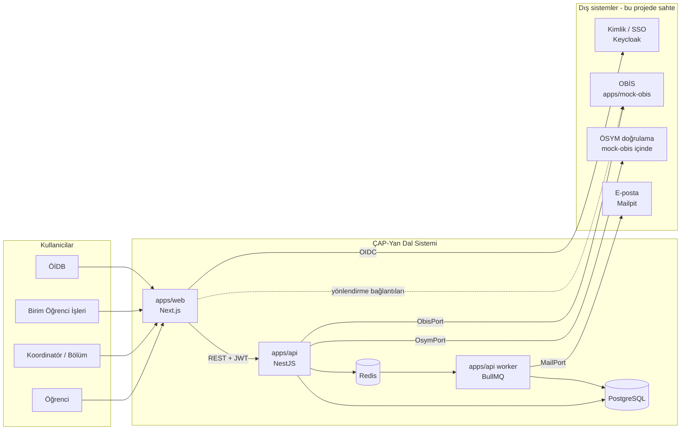
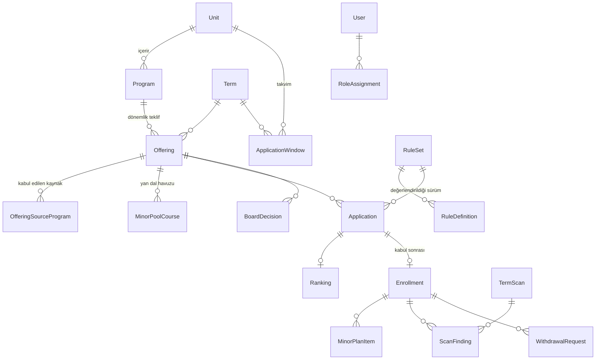
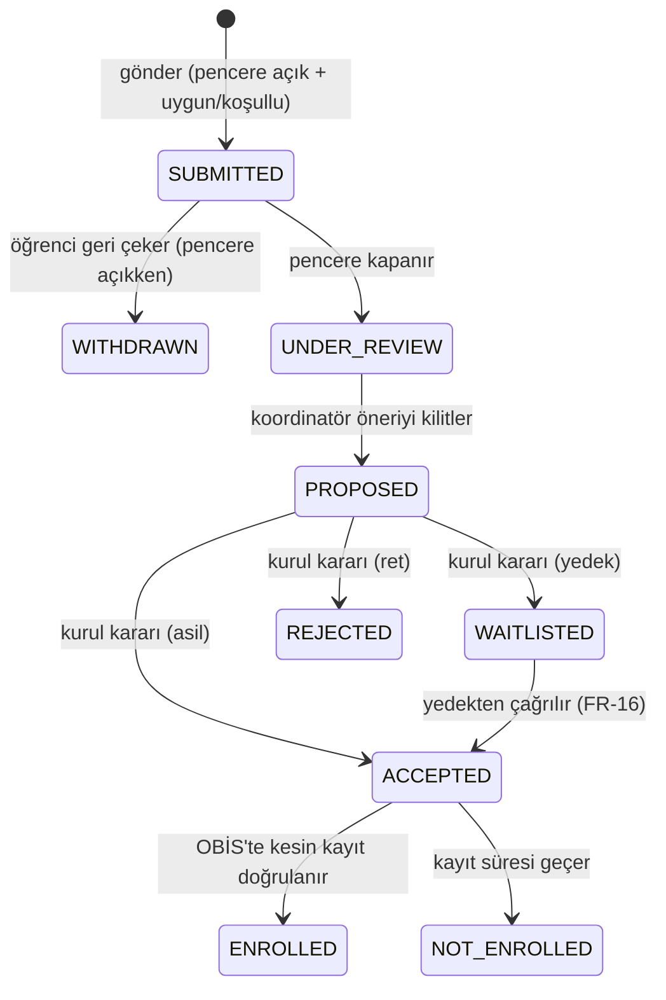
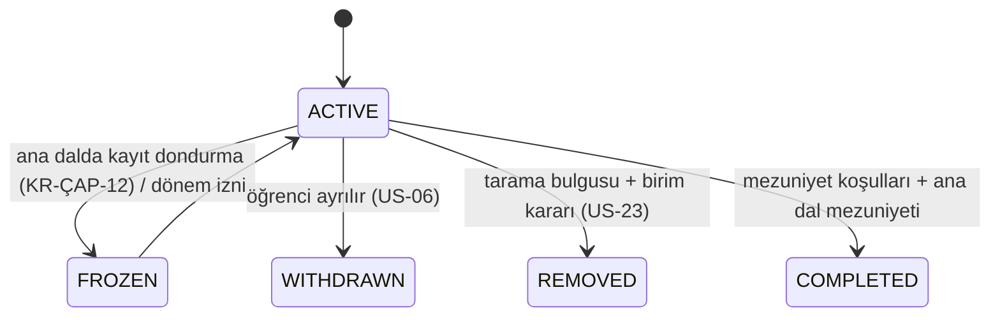
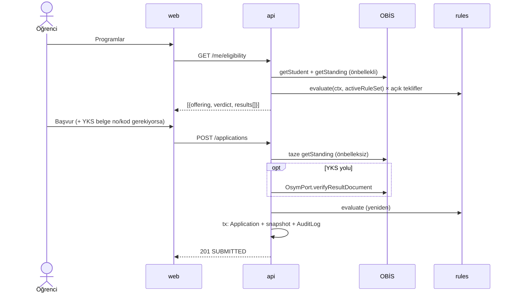

# Teknik Doküman — Çift Ana Dal ve Yan Dal Başvuru ve Takip Sistemi

| | |
|---|---|
| Sürüm | 0.1 (taslak) |
| Tarih | 2026-10-07 |
| İlgili belge | [PRD.md](PRD.md) (bu belgedeki FR-, US-, KR- ve AS- kimlikleri oradadır) |

Bu belge PRD'deki gereksinimlerin **nasıl** karşılanacağını tanımlar: mimari, teknoloji, veri modeli, kural motoru, API, ekranlar, güvenlik, test ve kurulum.

---

## 1. Mimari kararlar

| No | Karar | Gerekçe |
|---|---|---|
| K-01 | **Monorepo**: pnpm workspaces + Turborepo | Ön yüz, arka uç, sahte servisler ve ortak paketler tek depoda. Tipler ve kural motoru paylaşılır. |
| K-02 | **Ön yüz: Next.js** (App Router, TypeScript), Tailwind CSS + shadcn/ui | Kullanıcı tercihi. Sunucu bileşenleri ile hızlı ilk yükleme, mobil uyum. |
| K-03 | **Arka uç: NestJS** (TypeScript) | Kullanıcı tercihi. Modül yapısı, bağımlılık enjeksiyonu ve guard'lar rol/kapsam yetkisine ve port-adapter düzenine uygun. |
| K-04 | **Veritabanı: PostgreSQL**, ORM: **Prisma** | İlişkisel veri ve JSONB (anlık görüntüler, kural parametreleri). Prisma şema tabanlı göç ve tip üretimi sağlar. |
| K-05 | **Hexagonal (port-adapter) düzen**: dış sistemler arayüz arkasında | PRD 3.2: OBİS, ÖSYM ve kimlik doğrulama bu projede sahte. Gerçek uygulama sonradan yalnızca adapter değiştirilerek takılır. |
| K-06 | **Kural motoru ayrı ve saf bir TypeScript paketi** (`packages/rules`) | Veritabanına ve HTTP'ye bağımlı değil, birim testi kolay. Hem API'de hem gerekirse ön yüzde çalışır. |
| K-07 | **Kimlik doğrulama: OIDC**, geliştirmede **Keycloak** "üniversite SSO" yerine geçer | PRD: sistem kendi şifresini tutmaz. Gerçekte üniversite SSO'su da OIDC/SAML ile bağlanır. |
| K-08 | **Arka plan işleri: BullMQ + Redis** | Dönem sonu taraması, toplu bildirim ve e-posta uzun sürebilir, istek-yanıt döngüsünden ayrılmalı. |
| K-09 | **Sahte OBİS ayrı bir servis** (`apps/mock-obis`, NestJS) | Gerçek OBİS gibi ağ üzerinden çağrılır. Böylece zaman aşımı ve hata durumları da test edilir. |
| K-10 | **Saat dilimi Europe/Istanbul**. Veritabanında UTC saklanır, arayüzde tr-TR biçiminde gösterilir | Başvuru penceresinin açılış ve kapanış anları tartışmaya yer bırakmamalı. |

## 2. Sistem bağlamı



EBYS ile teknik bağlantı yok. Yönetim kurulu kararının yalnızca tarih, sayı ve sonucu girilir (PRD 3.2).

## 3. Depo yapısı

```
cap-yandal-otomasyonu/
├─ apps/
│  ├─ web/                 Next.js (öğrenci, koordinatör, birim, ÖİDB ekranları)
│  ├─ api/                 NestJS REST API + BullMQ worker (ayrı giriş noktası)
│  └─ mock-obis/           NestJS: sahte OBİS + sahte ÖSYM doğrulama
├─ packages/
│  ├─ rules/               Kural motoru (saf TS, bağımlılıksız)
│  ├─ contracts/           Paylaşılan DTO şemaları (zod) ve enum'lar
│  ├─ obis-client/         ObisPort tipleri + HTTP istemcisi
│  ├─ ui/                  Paylaşılan shadcn bileşenleri (isteğe bağlı)
│  └─ config/              eslint, tsconfig, prettier ayarları
├─ prisma/                 (apps/api içinde de olabilir) şema + göçler + seed
├─ infra/
│  ├─ docker-compose.yml   postgres, redis, keycloak, mailpit, mock-obis, api, web
│  └─ keycloak/realm.json  roller ve deneme kullanıcıları
├─ docs/                   PRD, teknik doküman, ADR'ler
└─ kaynaklar/              yönergeler
```

## 4. Arka uç (apps/api)

### 4.1 Modüller

| Modül | Sorumluluk | İlgili FR |
|---|---|---|
| `auth` | OIDC JWT doğrulama, kullanıcıyı ve rol atamalarını yükleme, `@Roles()` ve `@Scope()` guard'ları | — |
| `catalog` | Birim, bölüm, program; dönem; teklif (offering: program + dönem + tür + kontenjan + koordinatör + kaynak bölüm kısıtı); yan dal ders havuzu | FR-01, FR-11 |
| `calendar` | Birim bazlı başvuru takvimi, "pencere açık mı" sorgusu | FR-02 |
| `rules` | Kural seti sürümleri, `packages/rules`'u çağıran değerlendirme servisi | FR-03 |
| `eligibility` | Öğrenci × açık teklifler için uygunluk listesi | FR-04 |
| `applications` | Başvuru oluşturma, geri çekme, durum makinesi, OBİS anlık görüntüsü | FR-05, FR-06 |
| `evaluation` | Sıralama stratejisi, asil ve yedek önerisi, gerekçeli değiştirme | FR-07, FR-16 |
| `decisions` | Yönetim kurulu karar kaydı, sonuç yayımlama, dışa aktarma | FR-08, FR-09, FR-18 |
| `enrollments` | ÇAP ve yan dal kayıtları, yan dal planı, ayrılma talebi, ÇAP'tan yan dala geçiş | FR-11, FR-13, FR-14 |
| `monitoring` | Dönem sonu taraması (BullMQ işi), bulgular, kayıt silme aday listesi | FR-10 |
| `notifications` | Sistem içi bildirim ve e-posta kuyruğu | FR-12 |
| `reports` | Birim ve program istatistikleri | FR-15 |
| `audit` | Denetim kaydı (interceptor + servis) | 7.2 |
| `integrations` | Port tanımları ve adapter'lar: `ObisPort`, `OsymPort`, `MailPort`, `LinkRegistry` | FR-17 |

### 4.2 Katmanlar (her modül içinde)

```
controller  → yalnızca HTTP: DTO doğrulama (zod), yetki dekoratörleri, servis çağrısı
service     → iş akışı; transaction sınırı burada
domain      → durum makineleri, değer nesneleri, saf fonksiyonlar (Nest'e bağımlı değil)
repository  → Prisma erişimi (servis Prisma'yı doğrudan görmez)
```

### 4.3 Portlar (dış sistemler)

```ts
// packages/obis-client
export interface ObisPort {
  getStudent(studentNo: string): Promise<ObisStudent>;            // ad, program, sınıf, yarıyıl, öğretim türü, kayıt durumu
  getStanding(studentNo: string, termId: string): Promise<ObisStanding>;
  // { gano, yano, completedAllCoursesToDate, semesterNo, classRankPercentile, frozen, termsWithoutCourses }
  getTranscript(studentNo: string): Promise<ObisCourseResult[]>;
  getProgramTrackResults(studentNo: string, programId: string): Promise<ObisCourseResult[]>; // ÇAP/yan dal dersleri
  getEntryScore(studentNo: string): Promise<{ year: number; score: number; scoreType: string } | null>;
  getProgramBaseScore(programId: string, year: number): Promise<number | null>;
}

export interface OsymPort {
  verifyResultDocument(docNo: string, verificationCode: string): Promise<{ valid: boolean; year?: number; score?: number }>;
}
```

- Adapter seçimi ortam değişkeniyle yapılır: `OBIS_ADAPTER=mock|http`.
- Tüm OBİS çağrılarında 5 saniye zaman aşımı ve en fazla 2 yeniden deneme vardır.
- Uygunluk ekranı için öğrenci başına 5 dakikalık önbellek tutulur (Redis). Başvuru anında önbellek **kullanılmaz**, OBİS'ten taze veri çekilir.

## 5. Kural motoru (packages/rules)

### 5.1 Kavramlar

```ts
type RuleStatus = 'PASS' | 'FAIL' | 'WARN' | 'NOT_APPLICABLE';

interface RuleDefinition {
  code: string;          // 'KR-ÇAP-02'
  kind: string;          // 'MIN_GANO' — hangi değerlendiricinin çalışacağı
  article: string;       // 'ÇAP Yön. m.5/1-d'
  params: Record<string, unknown>; // { min: 2.75 }
  appliesTo: 'CAP' | 'YANDAL';
  phase: 'APPLICATION' | 'TERM_END' | 'GRADUATION' | 'CONFIGURATION';
}

interface RuleResult {
  code: string; article: string; status: RuleStatus;
  actual?: string | number; expected?: string | number;
  messageKey: string;    // arayüzde Türkçe metne çevrilir
}

interface EvaluationContext {   // OBİS anlık görüntüsü + teklif + öğrencinin sistemdeki durumu
  student: StudentSnapshot; offering: OfferingSnapshot;
  activeEnrollments: EnrollmentSnapshot[]; history: TrackHistory; now: Date;
}

type Evaluator = (ctx: EvaluationContext, params: any) => RuleResult;
```

- **Kurallar veridir**: kod, madde, tür ve parametre veritabanında, sürümlü kural setinde durur.
- **Değerlendiriciler koddur**: her `kind` için bir saf fonksiyon yazılır.
- Yönerge eşiği değişirse yalnızca kural seti güncellenir (PRD H5). Yeni tür bir koşul gelirse yeni değerlendirici yazılır.

### 5.2 Değerlendirici türleri (ilk sürüm)

| kind | Kullanan kurallar | Parametre |
|---|---|---|
| `ALL_COURSES_PASSED` | KR-ÇAP-01, KR-YD-01 | — |
| `MIN_GANO` | KR-ÇAP-02, KR-YD-02 | `min` |
| `ANY_OF` (bileşik) | KR-ÇAP-03 | `rules: [CLASS_RANK_TOP, ENTRY_SCORE_GTE_BASE]` |
| `CLASS_RANK_TOP` | KR-ÇAP-03a | `percent: 20` |
| `ENTRY_SCORE_GTE_BASE` | KR-ÇAP-03b | — |
| `SEMESTER_WINDOW` | KR-ÇAP-05, KR-YD-03 | `byDuration: {2:[2,3], 4:[3,5], 5:[3,7], 6:[3,9]}` |
| `MAX_ACTIVE_TRACKS` | KR-ÇAP-06, KR-YD-04 | `type, max` |
| `NOT_SAME_PROGRAM_BOTH` | KR-ÇAP-06 | — |
| `TALENT_EXAM_PASSED` | KR-ÇAP-07 | — |
| `SOURCE_PROGRAM_ALLOWED` | KR-ÇAP-08 | (teklifteki liste) |
| `MIN_QUOTA_RATIO` | KR-ÇAP-09 | `percent: 20, exemptCategories` (`phase: CONFIGURATION`) |
| `CONSECUTIVE_TERMS_NO_COURSE` | KR-ÇAP-10, KR-YD-08 | `terms: 2` |
| `GANO_DROP_STRIKES` | KR-ÇAP-11 | `firstThreshold: 2.50, secondThreshold: 2.72` (AS-1'e göre güncellenecek) |
| `MAIN_GANO_BELOW` | KR-YD-06 | `min: 2.30` |
| `TRACK_GPA_CONSECUTIVE_BELOW` | KR-YD-07 | `min: 2.00, terms: 2` |
| `NOT_PREVIOUSLY_REMOVED` | KR-YD-09 | — |
| `MINOR_PLAN_LIMITS` | KR-YD-05 | `minEcts: 30, minCourses: 6, poolMinEcts: 60` |
| `GRADUATION_CAP` | KR-ÇAP-13/14 | `minMainGano: 2.72, ectsByDuration` |
| `GRADUATION_MINOR` | KR-YD-10 | `minTrackGpa: 2.00` |

### 5.3 Uygunluk sonucu
- Herhangi bir kural `FAIL` ise sonuç **UYGUN DEĞİL**.
- `ANY_OF` kuralı yalnızca alt yollardan biriyle sağlanabiliyorsa ve o yol öğrenciden ek bilgi istiyorsa (ör. YKS belgesi) sonuç **KOŞULLU** olur.
- Diğer durumlarda sonuç **UYGUN**.
- Sonuç her zaman tüm kural sonuçlarının listesiyle döner (US-01). Sonuç ekranı bu listeden üretilir.

### 5.4 Sürümleme
- `RuleSet { version, type, effectiveFrom, status: DRAFT|ACTIVE|RETIRED }`
- Bir tarihte bir tür için yalnızca bir ACTIVE set olabilir.
- Başvuru ve tarama kayıtları `ruleSetId` saklar. Aynı girdi ve aynı sürümle aynı sonuç yeniden üretilebilir (PRD 7.3 izlenebilirlik).

### 5.5 Test yaklaşımı
- Her değerlendirici için **sınır değer tablosu** yazılır (ör. `MIN_GANO`: 2.74 → FAIL, 2.75 → PASS, 2.76 → PASS).
- Tablolar `packages/rules/test/fixtures/*.json` içinde tutulur. Aynı tablolar seed verisinde senaryo olarak tekrar kullanılır.
- Hedef: `packages/rules` için %100 dal kapsamı.

## 6. Veri modeli

Öğrencinin kişisel ve akademik verisi **OBİS'te** kalır. Bu sistemde yalnızca öğrenci numarası ile başvuru ve karar anlarının anlık görüntüsü tutulur (KVKK, PRD 7.3).



### 6.1 Tablolar (özet)

| Tablo | Önemli alanlar |
|---|---|
| `Unit` | id, code, name, kind (FAKULTE / YO / MYO / KONSERVATUVAR) |
| `Program` | id, unitId, obisProgramId, name, level (ONLISANS / LISANS), durationYears, educationType (I / II), category (MUHENDISLIK / HUKUK / TIP / SAGLIK / DIGER), requiresTalentExam, requiresSuccessRank |
| `Term` | id, year ("2026-2027"), season (GUZ / BAHAR), startsAt, endsAt |
| `Offering` | id, programId, termId, type (CAP / YANDAL), quota, coordinatorUserId, quotaJustification, status (DRAFT / APPROVED / PUBLISHED / CLOSED), firstYearIntake (KR-ÇAP-09 için) |
| `OfferingSourceProgram` | offeringId, programId (boşsa tüm programlar kabul edilir) |
| `MinorPoolCourse` | offeringId, courseCode, name, ects |
| `ApplicationWindow` | unitId, termId, type, opensAt, closesAt, reviewDeadline, announceAt |
| `RuleSet` / `RuleDefinition` | bkz. 5.4; params JSONB |
| `Application` | id, studentNo, offeringId, ruleSetId, path (RANK / ENTRY_SCORE), osymDocNo, osymVerified, obisSnapshot JSONB, eligibility JSONB, status, submittedAt, withdrawnAt; **benzersizlik**: (studentNo, offeringId) |
| `Ranking` | applicationId, score, rank, proposal (ASIL / YEDEK / RET), overriddenBy, overrideReason |
| `BoardDecision` | offeringId, decisionDate, decisionNo, recordedBy, publishedAt |
| `Enrollment` | id, studentNo, offeringId, applicationId, status (ACTIVE / FROZEN / WITHDRAWN / REMOVED / COMPLETED), startTermId, ganoStrikes, graceUntilTermId |
| `MinorPlanItem` | enrollmentId, poolCourseId, status (PROPOSED / APPROVED) |
| `TermScan` | id, termId, ruleSetId, startedAt, finishedAt, status |
| `ScanFinding` | scanId, enrollmentId, ruleCode, result JSONB, decision (PENDING / CONFIRMED / DISMISSED), decidedBy, reason |
| `WithdrawalRequest` | enrollmentId, reason, capToMinorOutcome JSONB (KR-ÇAP-17), status |
| `Notification` | userId / studentNo, type, payload, readAt |
| `User` | id, oidcSub, displayName, email |
| `RoleAssignment` | userId, role, unitId?, programId?, offeringId? (kapsam) |
| `AuditLog` | id, at, actorId, action, entity, entityId, before JSONB, after JSONB, reason, ip; **yalnızca ekleme** |

### 6.2 Kısıtlar
- **Değiştirilemez denetim kaydı:** `AuditLog` için UPDATE ve DELETE yasaklayan veritabanı tetikleyicisi.
- **Kontenjan:** Kabul edilen başvuru sayısı kontenjanı geçemez. Kurul kararı kaydında transaction içinde kontrol edilir.
- **KR-ÇAP-06 veritabanında da güvence altında:** Bir öğrencinin aynı türde en fazla bir ACTIVE kaydı olabilir. Bu kısmi benzersiz indeksle (`WHERE status='ACTIVE'`) sağlanır.

## 7. Durum makineleri

### 7.1 Başvuru



### 7.2 Kayıt (ÇAP / yan dal)



- `REMOVED` durumuna **yalnızca** onaylanmış bir `ScanFinding` üzerinden geçilir. Sistem kendiliğinden kayıt silmez (PRD US-23).

## 8. Akışlar

### 8.1 Başvuru



### 8.2 Dönem sonu taraması
1. Birim öğrenci işleri `POST /scans` ile taramayı başlatır. Not ilanından sonra cron ile de tetiklenebilir.
2. Worker, ilgili dönemdeki tüm ACTIVE ve FROZEN kayıtlar için OBİS'ten durumu çeker. TERM_END kurallarını çalıştırır, `ScanFinding` yazar.
3. `ganoStrikes` sayacı **yalnızca tarama onaylandığında** güncellenir. Taslak tarama yeniden çalıştırılabilir.
4. Koordinatöre ve birime özet bildirim gider. Uyarı (WARN) bulguları öğrenciye de bildirilir (US-05).
5. Birim her FAIL bulgusunu onaylar ya da gerekçeyle reddeder. Onaylanan bulgu kaydı `REMOVED` yapar.

### 8.3 Sıralama
- Strateji arayüzü: `RankingStrategy { score(app): number; tieBreak(a, b): number }`.
- Varsayılan `GanoThenRank`: GNO azalan; eşitlikte sınıf başarı yüzdeliği artan; o da eşitse başvuru zamanı.
- AS-2 yanıtlanınca strateji teklif bazında seçilebilir hâle gelir.

## 9. API (özet)

Temel yol `/api/v1`. Kimlik doğrulama: OIDC erişim belirteci (Bearer). Hatalar RFC 9457 `application/problem+json` biçiminde döner. Belgeler OpenAPI ile `@nestjs/swagger` üzerinden `/api/docs` adresinde.

| Yöntem | Yol | Rol | Açıklama |
|---|---|---|---|
| GET | `/me` | herkes | Kullanıcı, roller, kapsamlar |
| GET | `/me/eligibility?type=CAP\|YANDAL` | öğrenci | US-01 |
| GET | `/me/applications` | öğrenci | US-03 |
| POST | `/applications` | öğrenci | US-02 |
| POST | `/applications/:id/withdraw` | öğrenci | Geri çekme |
| GET | `/me/enrollments` | öğrenci | Kayıtlar, uyarılar, AKTS ilerlemesi |
| PUT | `/enrollments/:id/minor-plan` | öğrenci | US-04 |
| POST | `/enrollments/:id/minor-plan/approve` | koordinatör | US-04 |
| POST | `/enrollments/:id/withdrawal` | öğrenci | US-06 |
| GET/POST/PATCH | `/offerings` | bölüm başkanı, birim | US-10 (kontenjan uyarısı yanıtta `warnings[]` alanında) |
| GET/PUT | `/units/:id/windows` | birim | US-20 |
| GET | `/offerings/:id/applications` | koordinatör | Sıralı liste |
| POST | `/offerings/:id/ranking/lock` | koordinatör | US-11 öneriyi kilitle |
| PATCH | `/rankings/:applicationId` | koordinatör | Gerekçeli değişiklik |
| POST | `/offerings/:id/decision` | birim | US-21 karar kaydı |
| POST | `/offerings/:id/publish` | birim | Sonuç yayımla + bildirim |
| GET | `/offerings/:id/export?format=csv\|xlsx\|pdf` | birim | US-22, FR-18 |
| POST | `/scans` · GET `/scans/:id` | birim | US-23 |
| PATCH | `/scan-findings/:id` | birim | Onayla / reddet + gerekçe |
| GET/POST | `/rule-sets` · POST `/rule-sets/:id/activate` | ÖİDB | US-30 |
| POST | `/rule-sets/:id/dry-run` | ÖİDB | Yeni sürümü mevcut kayıtlar üzerinde etkisiz çalıştır, farkı göster |
| GET | `/reports/summary?termId&unitId` | birim, ÖİDB | US-31 |
| GET | `/links` | herkes | Dış sistem yönlendirme bağlantıları (FR-17) |
| GET | `/notifications` · POST `/notifications/:id/read` | herkes | FR-12 |

**Sahte OBİS** (`apps/mock-obis`, ayrı port): `GET /students/:no`, `/students/:no/standing?term=`, `/students/:no/transcript`, `/students/:no/tracks/:programId/results`, `/students/:no/entry-score`, `/programs/:id/base-score?year=`, `POST /osym/verify`. Bir de yalnızca geliştirmede açık olan `POST /_admin/scenario/:name` ucu var. Bu uç bir öğrenciyi istenen senaryoya getirir (ör. "GNO 2.49'a düşür").

## 10. Ön yüz (apps/web)

### 10.1 Rotalar

| Rota | Rol | İçerik |
|---|---|---|
| `/` | herkes | Rolüne göre yönlendirme |
| `/ogrenci/programlar` | öğrenci | Uygunluk listesi: program kartları, Uygun / Koşullu / Uygun değil rozeti, açılır kural listesi |
| `/ogrenci/basvuru/[offeringId]` | öğrenci | 3 adım: program → bilgileri onayla (OBİS'ten gelen değerler, salt okunur) → gönder |
| `/ogrenci/basvurularim` | öğrenci | Durum zaman çizelgesi, sonuç, OBİS kayıt yönlendirmesi |
| `/ogrenci/programlarim` | öğrenci | Aktif ÇAP / yan dal, uyarılar, AKTS ilerleme çubuğu, yan dal planı, ayrılma |
| `/koordinator/[offeringId]` | koordinatör | Başvuru tablosu (sıralı, filtreli), öneriyi kilitleme, değişiklik penceresi |
| `/koordinator/[offeringId]/ogrenciler` | koordinatör | Kayıtlı öğrenciler ve risk durumu |
| `/birim/takvim` · `/birim/teklifler` | birim, bölüm başkanı | Takvim, teklif ve kontenjan |
| `/birim/kararlar/[offeringId]` | birim | Karar kaydı, yayımla, dışa aktar |
| `/birim/taramalar` | birim | Tarama başlat, bulguları onayla |
| `/oidb/kurallar` | ÖİDB | Kural setleri, sürüm farkı, deneme çalıştırması (dry-run) |
| `/oidb/raporlar` | ÖİDB | Özet raporlar |

### 10.2 Kurallar
- **Veri çekme:** Sunucu bileşenlerinde, API'ye kullanıcının belirteciyle istek yapılır. İstemci tarafında TanStack Query yalnızca etkileşimli tablolarda kullanılır.
- **Formlar:** react-hook-form + `packages/contracts` içindeki zod şemaları. Sunucuyla aynı doğrulama kullanılır.
- **Kimlik doğrulama:** Auth.js (NextAuth) Keycloak OIDC sağlayıcısı ile. Rol bilgisi belirteçten okunur, son yetki kontrolü **API'de** yapılır.
- **Metinler:** Kural `messageKey` → Türkçe metin eşlemesi `apps/web/messages/tr.json` dosyasında. Madde atfı her zaman gösterilir.
- **Erişilebilirlik:** shadcn/Radix bileşenleri. Durum rozetleri yalnızca renge dayanmaz, ikon ve metin de taşır (WCAG 2.1 AA).

## 11. Güvenlik ve KVKK

| Konu | Uygulama |
|---|---|
| Kimlik | OIDC (Authorization Code + PKCE). API yalnızca imzası doğrulanmış JWT kabul eder. Kendi şifre deposu yok. |
| Yetki | RBAC + kapsam: `RoleAssignment` (rol, birim, program, teklif). Guard her istekte kapsamı denetler: koordinatör yalnızca kendi teklifini, birim yalnızca kendi birimini görür. Öğrenci yalnızca kendi `studentNo` verisine erişir (belirteçteki talepten okunur, istekten alınmaz). |
| Girdi | Tüm DTO'lar zod ile doğrulanır. Prisma parametreli sorgu kullanır. |
| Oran sınırlama | `@nestjs/throttler`: başvuru uçlarında kullanıcı başına dakikada 10 istek |
| Başlıklar | Helmet, sıkı CORS (yalnızca web kökeni), CSP (Next middleware) |
| Denetim | Değişiklik yapan her uç ve kişisel veri okuyan uçlar (`obisSnapshot`) `AuditLog`'a yazılır |
| Veri en aza indirme | OBİS verisi yalnızca anlık görüntü olarak ve yalnızca kural için gereken alanlarla saklanır (ad, numara, program, GNO, sınıf yüzdeliği, yarıyıl) |
| Saklama | Reddedilen ve geri çekilen başvuruların anlık görüntüsü 2 yıl sonra anonimleştirilir (süre ÖİDB'ye sorulacak). Zamanlanmış iş ile yapılır. |
| Sırlar | `.env` dosyaları depoya girmez. `.env.example` örnek değerlerle tutulur. |

## 12. Test stratejisi

| Düzey | Araç | Kapsam |
|---|---|---|
| Birim | Vitest | `packages/rules` (sınır tabloları, %100 dal), domain durum makineleri, sıralama stratejisi |
| Entegrasyon | Jest (Nest varsayılanı) + Testcontainers (PostgreSQL, Redis) | Servis + repository + gerçek veritabanı; kontenjan ve benzersizlik kısıtları |
| Sözleşme | `packages/obis-client` şemaları | Sahte OBİS yanıtlarının port tipleriyle uyumu |
| Uçtan uca (e2e) | Playwright | Ana senaryolar: uygunluk → başvuru → sıralama → karar → yayın → kayıt → tarama → kayıt silme |
| Kullanılabilirlik | 5–10 öğrenci, görev senaryoları + SUS anketi | PRD bölüm 8 |

**Seed senaryoları** (`prisma/seed`): 2026-27 güz kontenjan listesindeki **gerçek** programlar, kontenjanlar ve kaynak bölüm kısıtları kullanılır. Öğrenciler sahte ve adlandırılmış senaryolara bağlı:

- `uygun-klasik`: GNO 3.10, ilk %20, 3. yarıyıl
- `sinir-gno`: GNO 2.75 ve 2.74
- `yks-yolu`: GNO 2.90, %20 dışında, YKS puanı taban puanın üzerinde
- `pencere-disi`: 6. yarıyıl
- `kaynak-bolum-disi`: Teknoloji Fakültesi programına kısıt dışı bölümden başvuru
- `ikinci-cap`: zaten aktif bir ÇAP'ı var
- `yandal-gno-dususu`: ana dal GNO'su 2.29
- `cap-iki-darbe`: GNO iki dönem üst üste eşiğin altında
- `iki-donem-ders-yok`
- `cap-to-yandal`: ÇAP'tan ayrılıyor, yan dal gereklerini karşılıyor

## 13. Kurulum ve işletim

- **Geliştirme:** `pnpm i && docker compose -f infra/docker-compose.yml up -d && pnpm db:migrate && pnpm db:seed && pnpm dev`
- **Servisler ve portlar (öneri):**

  | Servis | Port |
  |---|---|
  | web | 3000 |
  | api | 4000 |
  | mock-obis | 4100 |
  | Keycloak | 8080 |
  | Mailpit | 8025 |
  | PostgreSQL | 5432 |
  | Redis | 6379 |

- **Deneme kullanıcıları:** `infra/keycloak/realm.json` her rol için birer kullanıcı içerir. Şifreler yalnızca bu yerel dosyada durur.
- **CI:** GitHub Actions. Sırasıyla lint → typecheck → birim testleri → entegrasyon testleri (Testcontainers) → build → Playwright (compose ile).
- **Gözlemlenebilirlik:** pino ile yapılandırılmış JSON log, istek kimliği (correlation id), `/health` (Terminus: DB, Redis, OBİS).
- **Sürümler:** Node.js 24 LTS. Next.js, NestJS ve Prisma kurulum anındaki güncel kararlı sürümlerine sabitlenir (`package.json` + lockfile).

## 14. Geliştirme sırası (PRD 9.2 ile eşlenmiş)

1. **Kasım 2026:** monorepo iskeleti, `packages/rules` + testler, `apps/mock-obis` + seed senaryoları, Keycloak realm
2. **Aralık 2026 – Ocak 2027:** `catalog`, `calendar`, `eligibility`, `applications`; öğrenci ekranları
3. **Şubat – Mart 2027:** `evaluation`, `decisions`, dışa aktarma, bildirimler; koordinatör ve birim ekranları
4. **Nisan 2027:** `enrollments`, `monitoring` (worker), yan dal planı, ayrılma, `reports`, kural yönetim ekranı
5. **Mayıs 2027:** Playwright senaryoları, kullanılabilirlik denemesi, performans ölçümü (k6 ile 500 eşzamanlı uygunluk isteği), tez

## 15. Açık teknik konular

| No | Konu | Bağlı olduğu |
|---|---|---|
| T-1 | `GANO_DROP_STRIKES` mantığı | AS-1 |
| T-2 | Varsayılan sıralama stratejisi | AS-2 |
| T-3 | Aynı dönemde birden çok ÇAP başvurusu ve tercih sırası (veri modelinde `preference` alanı gerekebilir) | AS-3 |
| T-4 | Sınıf başarı yüzdeliğini OBİS'ten okumak mı, kohort verisinden hesaplamak mı | AS-5 |
| T-5 | Saklama süreleri | ÖİDB |
| T-6 | Gerçek SSO protokolü (OIDC / SAML / CAS) | Bilgi İşlem; port sayesinde etkisi sınırlı |

## 16. Uygulama notları (v0.2, 2026-10-07)

Uygulama sırasında tasarımdan şu noktalarda ayrılındı:

| Konu | Tasarım (v0.1) | Uygulama | Gerekçe |
|---|---|---|---|
| Sürümler | Node 24, güncel kararlı | Node 22, Next.js 15.5, NestJS 11, Prisma 6, TypeScript 5.9, Zod 3 | Bir sonraki ana sürümler (Next 16, Nest 12, Prisma 7, TS 7) kırıcı değişiklik getiriyor |
| Kural mesajı | `messageKey` → `tr.json` | Değerlendirici Türkçe `message` üretir | Mesajlar kural değerine bağlı; tek yerde kalması daha az hataya açık |
| Worker | Ayrı giriş noktası | API süreci içinde, `WORKER_ENABLED` ile açılıp kapanır | Tek geliştirici, tek süreç; ölçek gerekirse ikinci süreç aynı bayrakla başlatılır |
| Entegrasyon testi | Testcontainers | docker-compose'taki PostgreSQL'de ayrı `cap_test` veritabanı, sahte OBİS/belirteç | Windows'ta daha hızlı ve kararlı |
| Web kimlik | Auth.js | next-auth v4 + Keycloak. Erişim belirteci yalnızca sunucuda çerezden çözülür, istemciye gönderilmez | |
| Formlar | react-hook-form | Sunucu eylemleri + `ActionForm`. Hata durumunda girilen değerler korunur | JS'siz de çalışan formlar, daha az istemci kodu |
| Oran sınırı | Kullanıcı başına | Belirteçteki `sub` ile; belirteç yoksa IP | Aynı ağdan gelen kullanıcılar birbirini engellemesin |
| Tarama kapsamı | — | Tüm birimleri kapsayan taramada birim personeli yalnızca kendi biriminin bulgularını görür | Testte bulunan veri sızıntısı düzeltildi |

**Test sonuçları:**
- `packages/rules`: 116 test, %100 satır ve dal kapsamı.
- `apps/api`: 12 entegrasyon testi (tam akış, yetki ve kısıtlar).
- `e2e`: 18 Playwright testi (11 adımlı arayüz akışı, ekran görüntüleri, 4 mobil kontrol).

## 17. Pivot: rol bazlı personel paneli (v0.3, 2026-10-08)

Kapsam kararı ve kaynakları: [KARARLAR.md](KARARLAR.md) (K-1 … K-11).

**Kaldırılanlar**
- Öğrenci rolü, öğrenci ekranları ve uçları (`/me/eligibility`, `/me/applications`, `/me/enrollments`, yan dal planı uçları).
- `MinorPlanItem` tablosu (yerini protokol aldı).
- OBİS kesin kayıt eşitlemesi (`sync-registrations`), `ObisPort.isRegistered`, sahte OBİS kayıt ekranı.

**Eklenenler**

| Alan | Uygulama |
|---|---|
| Yetki | Roller yalnızca `RoleAssignment` tablosundan okunur; Keycloak yalnızca kimlik doğrular. ÖİDB `/users`, `/users/:u/assignments`, `/assignments/:id` ile yönetir. Rolsüz kullanıcı ilk girişte kaydolur ama işlem yapamaz. |
| Başvuru girişi | `GET /intake/candidates?studentNo&type` (birimin teklifleri, uygunluk, yola göre zorunlu belgeler) ve `POST /applications` (evrak no/tarih, belge listesi, ÖSYM). Koşulu sağlamayan başvuru `INELIGIBLE` olarak kayda geçer, öğrenciye gerekçeli e-posta gider. |
| Kesin kayıt | `POST /applications/:id/register` (belge listesi, İİBF 2023-24). Kayıtta program danışmanı varsayılan olarak koordinatördür. |
| Protokol | `Protocol`, `ProtocolCourse`; `PUT /enrollments/:id/protocol`, `/submit`, `/file`. Kurallar: KR-ÇAP-18 (AKTS toplamı, ortak dersler dahil), KR-ÇAP-19 / KR-YD-13 (ana dal dersi yazılamaz), KR-YD-05. Onaylanmış protokolde değişiklik gerekçe ister ve yeni imza turu açar. |
| Onaylar | Genel `Approval` tablosu (konu, tur, rol, atanan kişi). İmzacılar formlardan alınmıştır: protokolde 5; ÇAP ders kaydında 5; yan dal ders kaydında 3. Ret, turun bekleyen imzalarını düşürür. Öğrencinin ıslak imzasını koordinatör ya da birim işler. |
| Ders kaydı | `CourseRegistration`, `CourseRegistrationItem`; kaydet → imzalar → koordinatör toplu teslim → birim OBİS listesi (CSV) → "girildi". Erasmus/Farabi izni olan dönemde ders kaydı yapılamaz. |
| Dönem izni | `TermLeave`; taramada izinli dönem "ders almama" sayılmaz (`history.onLeave`). |
| Görevlerim | `GET /me/tasks`: role göre bekleyen işler ve sayıları. |
| Denetim | `GET /audit` (ÖİDB); kayıt kimliği metin olarak döner (BigInt). |
| Müfredat | `ProgramCourse` (temsilî müfredatlar; ortak genel kültür dersleri işaretli). |
| Takvim | Pencereye asil kayıt, yedek kayıt ve ders kaydı son tarihleri eklendi. |
| Web | `(panel)` grubu: sol menü, Görevlerim, Onaylarım, Başvurular, Kayıt ayrıntısı, Protokoller, Ders kayıt formları, Toplu teslim, Kullanıcılar ve roller, Denetim; yazdırılabilir kontenjan ilanı, protokol formu ve sonuç listesi. Menü rolleri API'nin `/me` yanıtından alır. |

**Test sonuçları (v0.3)**
- `packages/rules`: 126 test, %100 kapsam.
- `apps/api`: 17 entegrasyon testi.
- `e2e`: 13 Playwright testi. 7 adımlı personel akışı; protokolün 5 imzası ve ders kaydının imzaları 4 farklı hesapla Keycloak girişi yapılarak atılıyor. Ayrıca ekran görüntüleri ve 4 mobil kontrol.

## 18. Pivot: bölüm kapsamı, öğrenci girişi, OBİS'siz veri modeli (v0.4, 2026-10-08)

Kararlar: [KARARLAR.md](KARARLAR.md) K-12 – K-17. Bu bölüm, önceki bölümlerle çeliştiği yerde geçerlidir. Veritabanı şemasının çizimi ve tablo listesi [taslak dosyasının](taslak/Proje-Taslak-Dosyasi.pdf) 6. bölümündedir ve `node docs/taslak/build.cjs` ile `schema.prisma` dosyasından üretilir.

**Kaldırılanlar.** `apps/mock-obis`, `ObisPort` / `OsymPort` ve HTTP adaptörleri; `Unit`, `ApplicationWindow`, `MinorPoolCourse`, `ProgramCourse` tabloları; `BIRIM` ve `OIDB` rolleri; başvuru girişi (intake), belge kontrollü kesin kayıt, protokol dosyalama, toplu teslim ve OBİS listesi uçları.

**Veri kaynağı.** Bağlam servisi (`rules/context.service.ts`) kural girdisini `StudentProfile` (öğrencinin beyanı) ve `YearStat` (taban puan, başarı sırası şartı) tablolarından kurar. Dönem sonu taraması üç iç kaynaktan çalışır: `TermRecord` (ana dal GNO beyanı), imzaları tamamlanmış `CourseRegistration` (ders alıp almadığı), `ProtocolCourse.grade` (program ortalaması).

**Beyana güven** (K-13). Belge içeriği sunucuda tür denetiminden geçer ve SHA-256 özeti saklanır. Doğrulanmamış başvuru varken sıralama kilitlenmez. Doğrulanmamış GNO beyanına dayanan bulgu onaylanamaz. Başvuru, verildiği andaki beyanı `snapshot` alanında saklar.

**Yetki.** Belirteçte rol yoktur; `AuthGuard` her istekte `RoleAssignment` satırlarını okur. Ataması olmayan hesap `OGRENCI` sayılır. `AccessService`: `isDepartmentStaff` (komisyon ya da Bilgisayar Müh. bölüm başkanı), `isHomeHead`, `canSeeStudent` (öğrencinin kendisi, bölüm personeli, ana dal bölüm başkanı, danışmanı).

**Modüller.**

| Modül | Dosya | Uçlar (özet) |
|---|---|---|
| Öğrenci | `students/students.ts` | `GET/PUT /me/profile`, `POST/DELETE /me/documents`, `GET /documents/:id` |
| Katalog | `catalog/*` | `/terms`, `/programs`, `/courses`, `/offerings` (CRUD, `close-now`, `public`), `/year-stats` |
| Başvuru | `applications/*` | `GET /me/eligibility`, `POST /applications`, `GET /applications`, `POST /applications/:id/verify`, `withdraw` |
| Değerlendirme | `review/*` | `GET /offerings/:id/applications`, `PATCH /rankings/:id`, `ranking/lock`, `decision`, `publish`, `POST /applications/:id/accept`, `close-registration`, `result`, `export` |
| Şablonlar | `forms/templates.ts` | `/protocol-templates` (liste, kayıt, PROTOCOL kuralları) |
| Formlar | `forms/forms.service.ts` | `PUT /enrollments/:id/protocol`, `protocol/submit`, `course-registration`, `grades`, `exemptions`, `/approvals/mine`, `POST /approvals/:id` |
| Kayıtlar | `enrollments/*` | `GET /enrollments`, `/me/enrollments`, `/main-department/students`, `term-record`, `leaves`, `advisor`, `withdrawal`, `complete` |
| Tarama | `monitoring/monitoring.ts` | `/scans`, `PATCH /scan-findings/:id` |
| Yönetim | `admin/admin.ts`, `rules/*`, `misc/misc.ts` | `/me/tasks`, `/users`, `/assignments`, `/audit`, `/rule-sets`, `/reports/summary` |

**İmza akışı.** `SIGNERS` (contracts) her form için imzacı rollerini verir: protokol 5, ders kayıt formu 3, muafiyet 3. `Approval.assigneeUsername` boşsa: `KOORDINATOR` satırını komisyonun herhangi bir üyesi imzalar; diğer rollerde hesabı olmayan imzacının ıslak imzasını koordinatör işler. Formu gönderenin kendi imzası gönderimle atılır. Ret, bekleyen imzaları düşürür; yeniden gönderim yeni tur açar.

**Protokol.** `ProtocolTemplate` bölümler arası belgedir (ÇAP: ana dal bölümü başına; yan dal: tek havuz). Öğrencinin `Protocol` kaydı şablonun kopyasıdır; `ProtocolCourse` satırı ders ya da seçmeli ders yeridir. Seçmeli yer, ders kayıt formunda aynı yarıyılın `TEKNIK_SECMELI` derslerinden biriyle doldurulur; ders geçilince `fulfilledCode` yazılır. Muafiyet onaylanınca hedef satır `EXEMPT` olur (not `M`, ortalamaya katılmaz, AKTS'ye sayılır).

**Belge deposu.** `UPLOAD_DIR` altında `<öğrenci no>/<uuid>.<uzantı>`; sürüm denetimine girmez. Erişim `GET /documents/:id` üzerinden yetkiyle; başkasının belgesini açan personel denetim kaydına yazılır.

**Veritabanı.** Göçler tek dosyada birleştirildi (`20261008150000_bolum_kapsami`). Geliştirme veritabanı `cap_bm`, test veritabanı `cap_bm_test`; önceki kapsamın `cap` ve `cap_test` veritabanlarına dokunulmadı.

**Testler.** 126 kural testi (%100 kapsam), 19 API entegrasyon testi, 18 Playwright testi (10 akış, 2 ekran görüntüsü, 6 mobil).

**Bilinen sınırlar.** İmzalanmış protokol değiştirilemez (şablon değişikliği yalnız yeni protokolleri etkiler). Ortak AKTS şablonda sayı olarak tutulur; ortak derslerin listesi tutulmaz. Kontenjan, taban puan ve yan dal havuzu temsilîdir (K-16).
